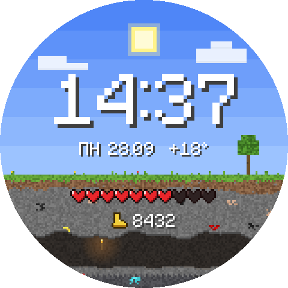
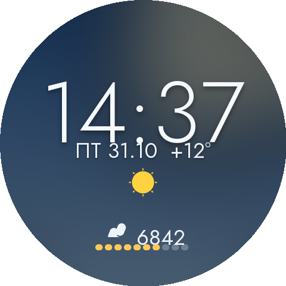

# Watch faces for Wear OS

Циферблаты для Wear OS на [Watch Face Format](https://developer.android.com/training/wearables/wff).

| Циферблат | |
|---|---|
| [**PixelCraft**](pixelcraft/): пиксельный мир с погодой, сердечками вместо батареи, шагами и мобами в пещере |  |
| [**Aurora**](aurora/): минималистичный градиент, погода с иконкой, температура и шаги с прогрессом |  |

Как установить на часы, описано в README каждого циферблата. Готовые APK лежат в [Releases](../../releases).
