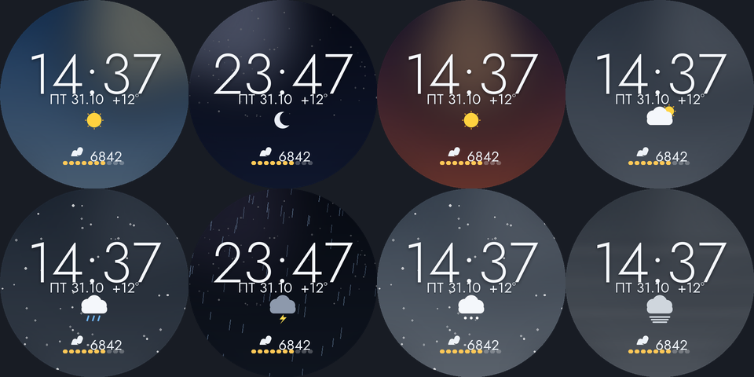

# Aurora: минималистичный циферблат для Wear OS

Циферблат для Wear OS 5+ в спокойном минималистичном стиле: градиентное небо,
тонкие цифры, погода и шаги. Сделан на [Watch Face Format](https://developer.android.com/training/wearables/wff).
Настраивали под экран 480×480 (Galaxy Watch 8, Wear OS 6).



## Что на экране

| | |
|---|---|
| **Время** | 24 часа, тонкий геометричный шрифт (Jost Light) |
| **Дата** | День недели по-русски и число: `ПТ 31.10` |
| **Погода** | Цветная иконка состояния и температура рядом с датой: `+12°` |
| **Фон** | Градиентное небо меняется по погоде: ясно, облачно, дождь, гроза, снег, туман — и по времени суток: день, ночь со звёздами, рассвет и закат |
| **Осадки** | Дождь и снег анимированы (looping WebP) |
| **Шаги** | Следы, счётчик шагов и полоска прогресса к дневной цели из 10 сегментов |
| **Always-On** | Только серые время и дата на чёрном фоне |

## Установка

Готовый APK лежит в [Releases](../../releases) (если там нет Aurora — соберите из исходников, см. ниже).

> Если открыть APK на телефоне, циферблат встанет на телефон, а не на часы.
> На часы его ставит приложение-установщик по Wi-Fi. Для этого на часах нужен режим разработчика.

### 1. Подготовка часов (один раз)

1. **Настройки → О часах → Программное обеспечение**. Нажмите 7 раз на **Версия ПО**, появятся «Параметры разработчика».
2. **Настройки → Параметры разработчика**: включите **Отладка ADB** и **Отладка по Wi-Fi**.
3. Часы и телефон (или компьютер) должны быть в одной сети Wi-Fi.

### 2а. Установка с телефона

1. Скачайте APK на телефон из Releases.
2. Установите из Google Play **Wear Installer 2** или **Bugjaeger**.
3. На часах откройте **Отладка по Wi-Fi → Сопряжение нового устройства**. Введите IP, порт и код в приложение на телефоне.
4. Выберите скачанный APK и нажмите «Установить».

### 2б. Установка с компьютера (adb)

```bash
adb pair IP:ПОРТ_СОПРЯЖЕНИЯ      # код с экрана часов
adb connect IP:ПОРТ              # с главного экрана «Отладки по Wi-Fi»
adb install Aurora-1.0.0.apk
```

### 3. Включить циферблат

Зажмите текущий циферблат, пролистайте до **Добавить** и выберите **Aurora**.
Или в Galaxy Wearable на телефоне откройте **Циферблаты**.

После установки режим разработчика можно выключить.

## Сборка из исходников

Нужны JDK 17, Android SDK (платформа 36) и Python 3.

```bash
cd aurora
python3 -m venv .venv && .venv/bin/pip install -r tools/requirements.txt
echo "sdk.dir=$HOME/Library/Android/sdk" > local.properties   # путь к вашему SDK
./build.sh                # APK появится в dist/
./build.sh install        # собрать и поставить на подключённые часы
FORCE_SCENE=storm_night ./build.sh install   # посмотреть конкретную погоду
```

Всю графику рисует код в `tools/art.py`, PNG и XML руками не правятся:

| Файл | Что делает |
|---|---|
| `tools/art.py` | Градиентные фоны, иконки погоды, кадры осадков, глифы шрифта |
| `tools/build_assets.py` | Экспорт PNG и анимированных WebP в `res/drawable-nodpi` |
| `tools/gen_watchface.py` | Генерация `res/raw/watchface.xml`: выбор фона и иконки по погоде |
| `tools/mockups.py` | Картинки для этого README |
| `tools/fonts/Jost.ttf` | Шрифт [Jost](https://fonts.google.com/specimen/Jost) (SIL Open Font License) |

**Проверка XML (необязательно).** Соберите валидатор из [google/watchface](https://github.com/google/watchface)
(`third_party/wff`, `./gradlew :specification:validator:executable-jar`) и положите `wff-validator.jar` в `tools/bin/`.
Тогда `build.sh` будет проверять XML при каждой сборке.

**Подпись релиза.** Положите рядом с `settings.gradle.kts` файл `keystore.properties` с полями `storeFile`, `storePassword`, `keyAlias` и `keyPassword`.
Без него релиз подписывается отладочным ключом.

### Как работает погода

Фон и иконка выбираются по `[WEATHER.CONDITION]` и `[WEATHER.IS_DAY]`. Закатный фон включается за час до смены дня на ночь по прогнозу, рассветный за час до смены ночи на день — для этого сравниваются текущий час и `[WEATHER.HOURS.1.IS_DAY]`.
Если данных о погоде нет (или они старше 90 минут), фон дневной с 07:00 до 19:59, рассвет в 6 часов, закат в 19.
