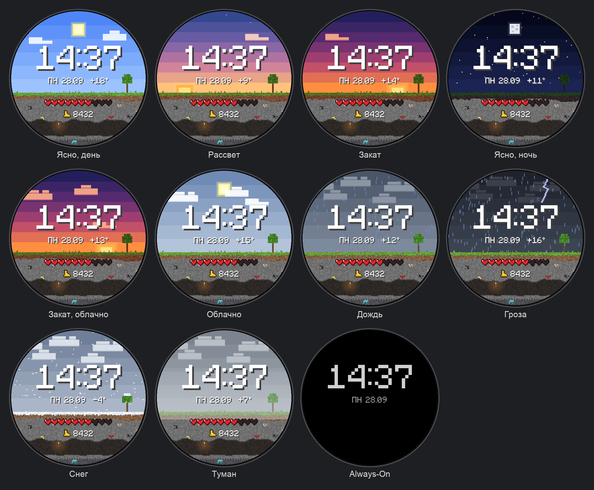
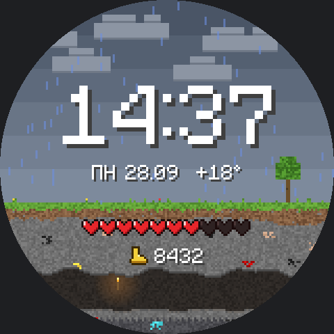
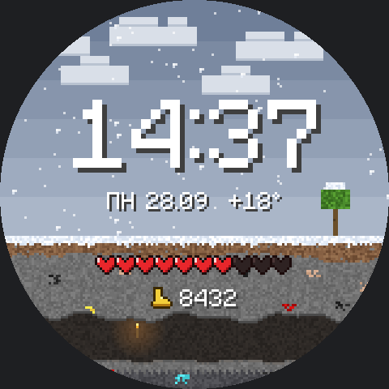
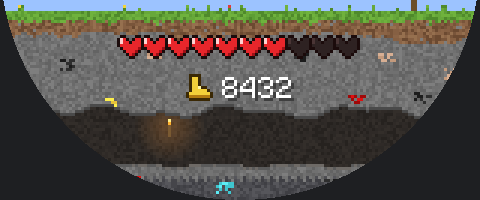
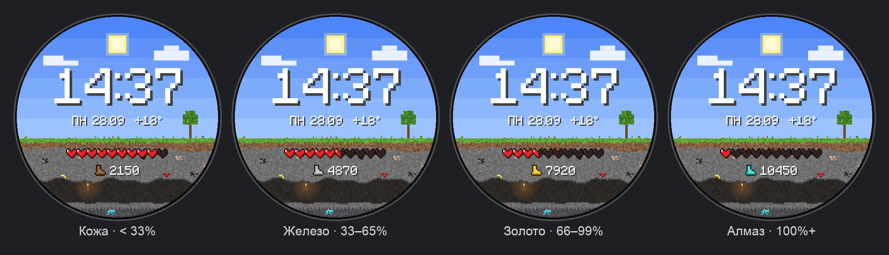
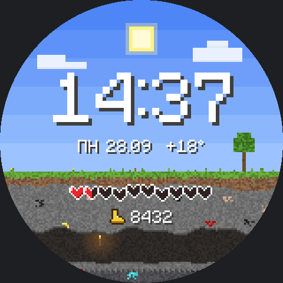

# PixelCraft: пиксельный циферблат для Wear OS

Циферблат для Wear OS 5+ в стиле блочных игр, сделан на [Watch Face Format](https://developer.android.com/training/wearables/wff).
Настраивали под Galaxy Watch 8 (Wear OS 6), экран 480×480.



## Что на экране

| | |
|---|---|
| **Время** | 24 часа, крупный пиксельный шрифт |
| **Дата** | День недели по-русски и число: `ПН 28.09` |
| **Погода** | Температура, а фон меняется по погоде: ясно, облачно, дождь, гроза, снег, туман |
| **Время суток** | День, ночь со звёздами и луной, отдельные фоны на рассвет и закат |
| **Батарея** | 10 сердечек, одно сердце равно 10%. Ниже 20% сердечки мигают и подпрыгивают |
| **Шаги** | Счётчик и ботинок, материал которого зависит от прогресса к дневной цели: кожа, железо, золото, алмаз |
| **Always-On** | Только серые время и дата на чёрном фоне |

### Анимации

- Облака плывут по небу, в грозу быстрее.
- Дождь и снег падают, снежинки покачиваются.
- В пещере под землёй раз в 3 часа (00:00, 03:00, 06:00 и так далее, первые 5 минут часа) пробегает моб: крипер, зомби или свинья.
  **Если тапнуть по пещере, моб пройдёт в любое время.**

| Дождь | Снег | Мобы |
|---|---|---|
|  |  |  |

| Ботинки по прогрессу шагов | Мало заряда |
|---|---|
|  |  |

## Установка

Готовый APK лежит в [Releases](../../releases). Скачайте `PixelCraft-x.y.z.apk`.

> Если открыть APK на телефоне, циферблат встанет на телефон, а не на часы.
> На часы его ставит приложение-установщик по Wi-Fi. Для этого на часах нужен режим разработчика.

### 1. Подготовка часов (один раз)

1. **Настройки → О часах → Программное обеспечение**. Нажмите 7 раз на **Версия ПО**, появятся «Параметры разработчика».
2. **Настройки → Параметры разработчика**: включите **Отладка ADB** и **Отладка по Wi-Fi**.
3. Часы и телефон (или компьютер) должны быть в одной сети Wi-Fi.

### 2а. Установка с телефона

1. Скачайте APK на телефон из Releases.
2. Установите из Google Play **Wear Installer 2** или **Bugjaeger**.
3. На часах откройте **Отладка по Wi-Fi → Сопряжение нового устройства**. Введите IP, порт и код в приложение на телефоне.
4. Выберите скачанный APK и нажмите «Установить».

### 2б. Установка с компьютера (adb)

```bash
adb pair IP:ПОРТ_СОПРЯЖЕНИЯ      # код с экрана часов
adb connect IP:ПОРТ              # с главного экрана «Отладки по Wi-Fi»
adb install PixelCraft-1.1.0.apk
```

### 3. Включить циферблат

Зажмите текущий циферблат, пролистайте до **Добавить** и выберите **PixelCraft**.
Или в Galaxy Wearable на телефоне откройте **Циферблаты**.

После установки режим разработчика можно выключить.

### Обновление

Новую версию из Releases ставьте тем же способом поверх старой.
Если установщик пишет о конфликте подписи (так бывает при переходе с самой первой тестовой сборки), удалите старый PixelCraft с часов и поставьте заново.

## Сборка из исходников

Нужны JDK 17, Android SDK (платформа 36) и Python 3.

```bash
cd pixelcraft
python3 -m venv .venv && .venv/bin/pip install -r tools/requirements.txt
echo "sdk.dir=$HOME/Library/Android/sdk" > local.properties   # путь к вашему SDK
./build.sh                # APK появится в dist/
./build.sh install        # собрать и поставить на подключённые часы
FORCE_SCENE=storm_night ./build.sh install   # посмотреть конкретную погоду
```

Всю графику рисует код в `tools/pixelart.py`, PNG и XML руками не правятся:

| Файл | Что делает |
|---|---|
| `tools/pixelart.py` | Спрайты, шрифт, фоны, подземелье, мобы, осадки |
| `tools/build_assets.py` | Экспорт PNG и анимированных WebP в `res/drawable-nodpi` |
| `tools/gen_watchface.py` | Генерация `res/raw/watchface.xml`: выбор фона по погоде, сердечки, мобы |
| `tools/mockups.py` | Картинки и GIF для этого README |

**Проверка XML (необязательно).** Соберите валидатор из [google/watchface](https://github.com/google/watchface)
(`third_party/wff`, `./gradlew :specification:validator:executable-jar`) и положите `wff-validator.jar` в `tools/bin/`.
Тогда `build.sh` будет проверять XML при каждой сборке.

**Подпись релиза.** Положите рядом с `settings.gradle.kts` файл `keystore.properties` с полями `storeFile`, `storePassword`, `keyAlias` и `keyPassword`.
Без него релиз подписывается отладочным ключом.

### Как работает погода

Фон выбирается по `[WEATHER.CONDITION]` и `[WEATHER.IS_DAY]`. Закатный фон включается за час до смены дня на ночь по прогнозу, рассветный за час до смены ночи на день. Для этого сравниваются текущий час и `[WEATHER.HOURS.1.IS_DAY]`.
Если данных о погоде нет, фон дневной с 07:00 до 19:59, рассвет в 6 часов, закат в 19.

---

Фанатский проект. Не связан с Mojang Studios и Microsoft. Minecraft — торговая марка Mojang Synergies AB.
Вся графика нарисована с нуля кодом в `tools/pixelart.py`, игровые текстуры не используются.
